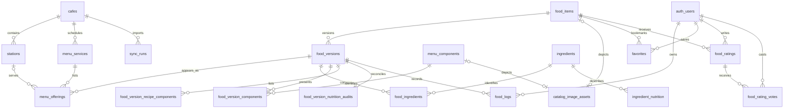

# SCU Dining database design

The SCU Supabase project uses the migrations in `supabase/migrations/`.
Their filenames match the project’s applied migration history. For a new
environment, apply the migrations in timestamp order.

## Relationships



## Core decisions

- `food_items` is a source item's stable identity. Do not merge foods by name.
  Source IDs are text: the local export contains recipe IDs like `48575.3`.
  Source item ID stability across days still needs verification.
- `food_versions` holds the name, description, ingredient text, serving and
  nutrition as published at a particular point in time. Updates and deletes are
  blocked by a trigger. An import inserts a new version when content changes.
- All food-version nutrients are per ONE published serving. A serving label such
  as `12.7 oz.` is retained exactly; `serving_weight_g` is optional and only filled
  when a mass conversion is justified. Never interpret fluid ounces as weight.
- `NULL` means unknown; zero means the source explicitly reports zero. Empty
  allergen tags do not prove allergen absence. Preserve source warning semantics.
- Description and ingredient text are separate: the supplied export has cases
  where these differ. Do not overwrite either with the other.
- Recipe IDs are stored as a text array because the current requirement does not
  need a separately maintained recipe catalog. They are not ingredient IDs.
- Meal periods are separate rows, even when both are named Lunch. Dates refer to
  the cafe's local calendar. Service timestamps are absolute timestamptz values.
- An offering is a food served at a station in a meal period on one day. Price,
  section, ordering and availability belong here, not on the permanent food.
  `is_listed` means listed on the source menu, not guaranteed in stock.
- `food_ingredients` is optional normalization for search. Preserve nested raw
  text; a simple comma split will misparse composite ingredients. Quantities stay
  NULL unless actually known. Normalization never drives dish nutrition totals.
- `ingredient_nutrition` is optional, sourced independently, per 100 g for the
  stated preparation. Leave it empty until verified data is available.
- `menu_components` holds prepared foods and ingredients used in the visual
  menu. `food_version_components` orders those links and groups alternatives
  such as the three bibimbap proteins under one choice.
- `food_version_recipe_components` records the source recipe breakdown and
  serving evidence. Candidate portions, proxy estimates and implied remainders
  retain their provenance. `food_versions.published_nutrition` preserves raw
  display values such as `< 1`, while unrepresentable numeric values stay NULL.
- `catalog_image_assets` records the exact generation prompt and settings
  for each item or component. Empty storage fields indicate a pending upload.
  The November 18 PNGs are linked to the private `scu-menu-photos` bucket
  under `dishes/` and `components/`. The backend can issue signed URLs for
  display. The image manifest records the same stable bucket and object paths.
- Favorites point to stable foods; logs point to immutable versions. Future
  tracking multiplies each published nutrient by `servings`. A trigger computes
  `local_date` from `eaten_at` and `timezone`; clients can omit `local_date`.

## Import contract

The November 18 Marketplace import is limited to the 63 curated dishes and
their components. Generate its transactional SQL with
`python3 "scripts/menu/build_scu_supabase_import.py"`. Its audit record marks
the snapshot as partial. The import does not delist offerings outside that scope.

1. Create a backend-only sync record for the cafe/date and preserve its payload.
2. Parse the whole response before publishing. Do not treat a network or parsing
   failure as an empty menu or a closure.
3. Upsert cafes, stations and foods by their source keys. Update food last-seen.
4. Hash canonicalized content including name, description, ingredients, serving,
   nutrient values, tags and recipe IDs. Exclude retrieval timestamps and menu
   occurrences. Sort tag sets and normalize numeric formats before hashing.
5. Insert versions with `ON CONFLICT (food_item_id, content_hash) DO NOTHING`.
   Fetch the existing version if unchanged; do not use DO UPDATE because the
   version trigger rejects it. Later nutrition enrichment creates a new version.
6. Upsert meal periods by `(cafe_id, service_date, source_key)` and offerings by
   `(menu_service_id, source_occurrence_key)`. Prefer actual source IDs. Otherwise
   derive stable keys from station, item, section and variant identifiers. Do not
   include recipe content hashes or array positions in occurrence keys.
7. In one transaction, publish the validated scope and mark missing offerings
   `is_listed = false`. Reconcile missing meal periods too. Only reconcile a scope
   for which the source response is complete; partial imports must not hide rows.
8. Mark the sync successful and update affected service freshness in that same
   transaction. Serialize concurrent imports for a cafe/date, e.g. with a Postgres
   advisory transaction lock, to prevent an older response overwriting a newer one.
   On failure retain the last successful menu and record the error separately.

## Example menu query

Use bound parameters rather than string interpolation. `$1` is cafe UUID and `$2`
is the requested SCU local date. This returns every listed food with its serving
and nutrition; it does not hide missing nutrition.

```sql
select s.service_date, s.name as meal, s.starts_at, s.ends_at,
       s.last_successful_sync_at, st.name as station,
       o.id as offering_id, o.price, o.currency, v.*
from public.menu_services s
join public.menu_offerings o on o.menu_service_id = s.id
left join public.stations st on st.id = o.station_id
join public.food_versions v on v.id = o.food_version_id
where s.cafe_id = $1 and s.service_date = $2
  and s.status = 'published' and o.is_listed
order by s.starts_at nulls last, st.name, o.sort_order, v.name;
```

Fetch menu_services separately when displaying closed/unpublished states; the
item query cannot return an empty service. Freshness is separate from status.

## Future diary totals

Avoid silently undercounting missing nutrition. Return both the sum of known
values and a missing-data count, and label the result as partial when needed.

```sql
select l.local_date,
       sum(v.calories_kcal * l.servings) as known_calories_kcal,
       count(*) filter (where v.calories_kcal is null) as calories_missing_count,
       sum(v.protein_g * l.servings) as known_protein_g,
       count(*) filter (where v.protein_g is null) as protein_missing_count
from public.food_logs l
join public.food_versions v on v.id = l.food_version_id
where l.user_id = (select auth.uid()) and l.local_date = $1
group by l.local_date;
```

## Access and validation

### Ratings and recommendations

- `food_ratings` stores one editable rating per signed-in user and stable
  `food_item_id`. Saved ratings are whole stars from 1 through 5, and comments
  are optional with a 2,000-character limit. A missing row displays as 0
  (unrated). To clear a rating, delete that user's rating for the item.
- Call `save_food_rating` using the signed-in client's session and pass
  `p_food_item_id`, `p_stars` and optional `p_comment`. It creates or updates
  the rating and replaces the comment. Omitted or blank comments clear it.
- Query `food_rating_stats` for the community average, rating count and
  counts for 1 through 5 stars. A listed item with no ratings has no stats row. Signed-in
  users can read the aggregates.
- Ratings and comments are private by default. The owner can set `is_shared`
  to show a review's stars and comment in `shared_food_reviews` for signed-in
  users. The view also returns upvotes, downvotes and their difference. It
  omits author and voter IDs. Unsharing hides the review and pauses voting.
- Call `save_food_rating_vote` with `p_review_id` and `p_vote` of `1` for
  upvote, `-1` for downvote or `0` to remove a vote. Each signed-in user
  has one vote per shared review and cannot vote on their own review. Users
  can read their own vote from `food_rating_votes`. Review votes are separate
  from the meal's star average.
- The existing `favorites` bookmarks and a user's `food_ratings` share the
  same item IDs. A future recommendation flow can use both without losing
  reviews when the menu version changes.

### Permissions and checks

Catalog tables are publicly readable and writable only by the backend. Sync
payloads have no client access. Authenticated users can CRUD only their own logs
and favorites. Ratings use owner policies and column-level write grants.
Keep the
service-role credential in the importer backend, never in the iOS app.

The component, recipe evidence, audit and image prompt tables are backend-only.
Review them in the Supabase Table Editor or use a backend with the service role.

Reference: https://supabase.com/docs/guides/database/postgres/row-level-security

Before deployment, run the migration in a disposable Supabase project and verify:
anonymous catalog reads succeed and writes fail; one user's logs are invisible to
another; duplicate source keys are rejected; mismatched cafe/station relationships
fail; food versions cannot be mutated; diary dates honor timezone boundaries;
failed imports preserve the last successful menu.

Run `supabase/tests/food_ratings.sql` as postgres to check rating validation,
owner isolation, edits, deletion and aggregates with rolled-back fixtures.
Run `supabase/tests/food_rating_votes.sql` to verify review visibility,
vote permissions and counts.
